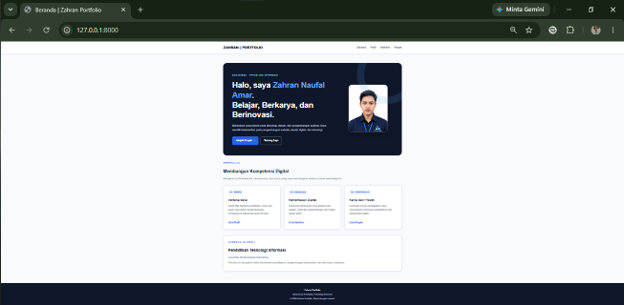
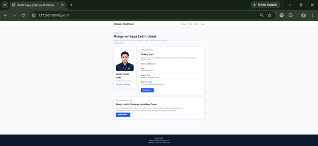
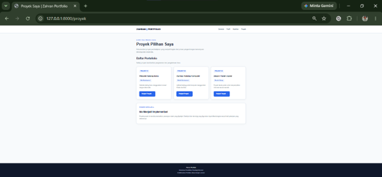
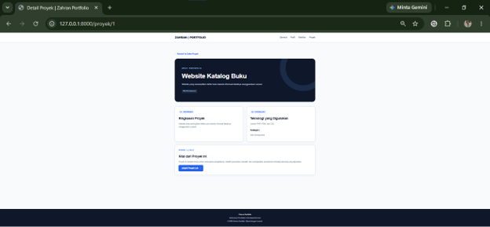
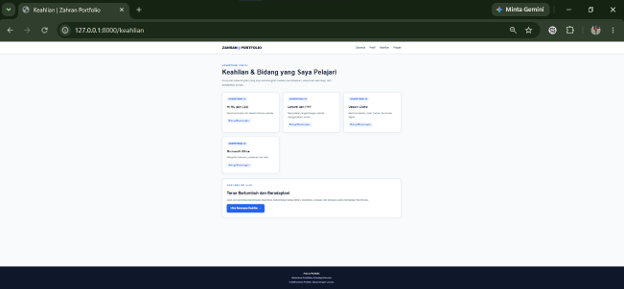

# 🎓 Portofolio Mahasiswa

Website portofolio mahasiswa yang dikembangkan menggunakan framework Laravel. Website ini menampilkan profil mahasiswa, informasi akademik, keahlian, dan proyek yang telah dikerjakan.

## 👩‍🎓 Identitas Mahasiswa

- **Nama:** ZAHRAN NAUFAL AMAR
- **NIM:** C2483207012
- **Kelas:** PTI5
- **Program Studi:** Pendidikan Teknologi Informasi
- **Perguruan Tinggi:** Universitas Muhammadiyah Tasikmalaya

## 📌 Deskripsi Proyek

Portofolio Mahasiswa merupakan aplikasi berbasis web yang dibuat untuk menerapkan konsep Routing, Model-View-Controller (MVC), Controller, dan Blade Template pada Laravel.

Website ini dirancang sebagai media untuk memperkenalkan identitas mahasiswa, menampilkan keterampilan yang dimiliki, serta mendokumentasikan proyek yang pernah dibuat.

Aplikasi menggunakan data statis berupa array PHP tanpa menggunakan database.

## ✨ Fitur Website

1. **Beranda** — halaman utama yang memperkenalkan mahasiswa.
2. **Profil** — menampilkan informasi diri dan akademik.
3. **Keahlian** — menampilkan keterampilan yang sedang dikembangkan.
4. **Daftar Proyek** — menampilkan kumpulan proyek mahasiswa.
5. **Detail Proyek** — menampilkan informasi lengkap berdasarkan ID proyek.

## 🛠️ Teknologi yang Digunakan

- PHP
- Laravel
- Blade Template
- HTML
- CSS

## 📂 Struktur Halaman

```text
resources/
└── views/
    ├── layouts/
    │   └── app.blade.php
    ├── beranda.blade.php
    ├── profil.blade.php
    ├── keahlian.blade.php
    ├── proyek.blade.php
    └── detail-proyek.blade.php
```

## 🔗 Implementasi Routing

Website menggunakan lima route utama:

| URL | Fungsi |
|---|---|
| `/` | Menampilkan halaman beranda |
| `/profil` | Menampilkan profil mahasiswa |
| `/keahlian` | Menampilkan keahlian mahasiswa |
| `/proyek` | Menampilkan daftar proyek |
| `/proyek/{id}` | Menampilkan detail proyek berdasarkan ID |

Route `/proyek/{id}` menggunakan parameter URL untuk menampilkan detail proyek tertentu.

## 🧩 Implementasi Controller

Aplikasi menggunakan dua Controller:

- **HomeController** — menangani halaman beranda dan profil mahasiswa.
- **PortofolioController** — menangani halaman keahlian, daftar proyek, dan detail proyek.

Data mahasiswa, keahlian, dan proyek disimpan dalam array PHP, kemudian dikirim ke View menggunakan fungsi `view()`.

## 🎨 Implementasi View

Halaman website dibuat menggunakan Blade Template Laravel dengan penerapan:

- `@extends` untuk menggunakan layout utama.
- `@section` untuk menentukan isi halaman.
- `@yield` untuk menampilkan konten halaman.
- `{{ }}` untuk menampilkan data.
- `@foreach` untuk menampilkan data dalam bentuk perulangan.

Layout utama digunakan bersama agar tampilan navigasi dan desain setiap halaman tetap konsisten.

## 📸 Screenshot Website

Tambahkan screenshot asli website pada folder `screenshots/`.

### 1. Beranda



### 2. Profil Mahasiswa



### 3. Daftar Proyek



### 4. Detail Proyek



### 5. Keahlian



## 🚀 Cara Menjalankan Proyek

### Persyaratan

- PHP sesuai persyaratan versi Laravel.
- Composer.
- Git.

### Langkah Menjalankan

1. Clone repositori:

   ```bash
   git clone https://github.com/zahrannaufalamar02/PortofolioZahranNaufalAmar
   ```

2. Masuk ke direktori proyek:

   ```bash
   cd zahran-portofolio
   ```

3. Instal dependensi:

   ```bash
   composer install
   ```

4. Jalankan server Laravel:

   ```bash
   php artisan serve
   ```

5. Buka browser dan akses:

   ```text
   http://127.0.0.1:8000
   ```

**Catatan:** Sesuaikan perintah PHP dengan instalasi PHP yang digunakan pada komputer.

## 🎯 Tujuan Pembelajaran

Proyek ini bertujuan untuk memahami penerapan routing, Controller, dan View pada Laravel, mengelola data statis menggunakan array PHP, serta membangun website responsif menggunakan Blade Template, HTML, dan CSS.

## 📝 Penutup

Website Portofolio Mahasiswa merupakan proyek pembelajaran pengembangan web yang digunakan untuk menampilkan profil, keahlian, dan hasil karya mahasiswa sekaligus menerapkan konsep dasar pengembangan aplikasi menggunakan Laravel.
